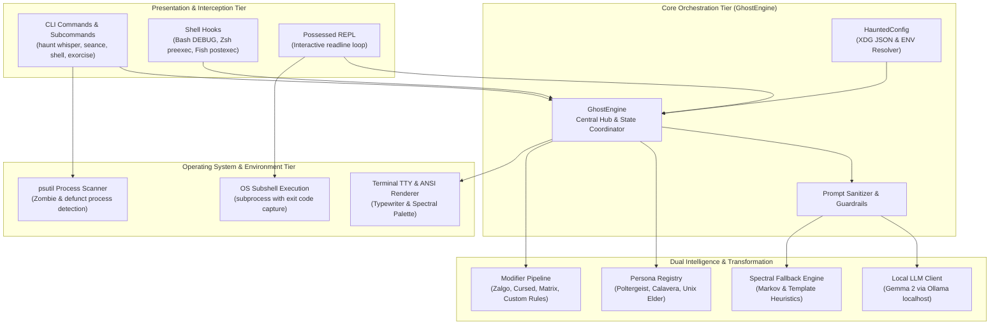
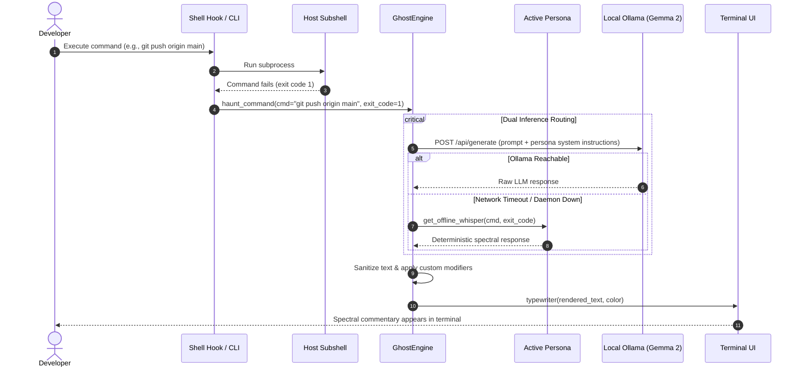
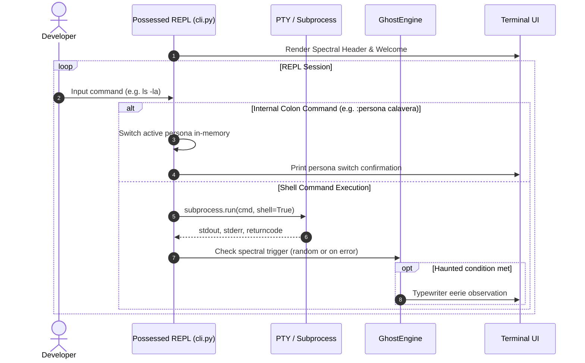
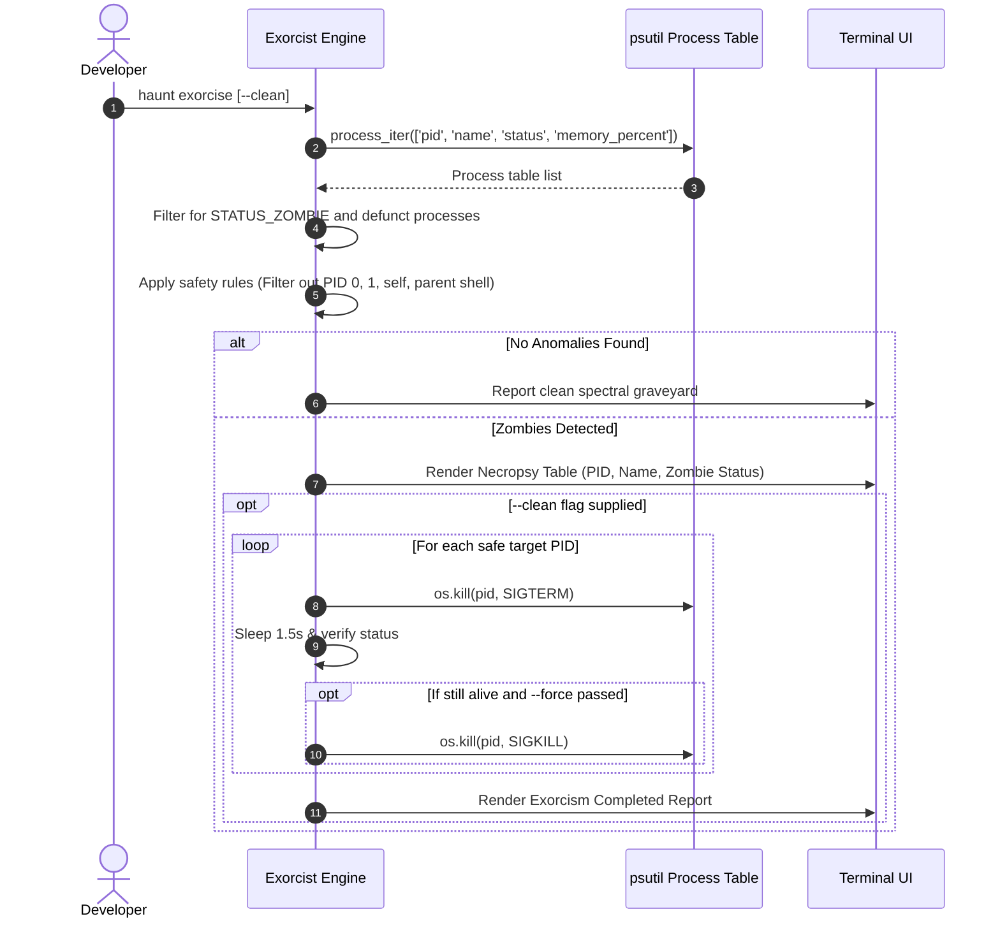

# 🏛️ Architecture & System Design: `haunted-shell`

Welcome to the internal architecture specification for **`haunted-shell`** (Ghost in the Machine). This document outlines the system topology, component interactions, security boundaries, and data pipelines powering our privacy-first, air-gapped terminal companion.

---

## 📑 Table of Contents
1. [Core Design Philosophy](#-core-design-philosophy)
2. [High-Level Architecture](#-high-level-architecture)
3. [Component Breakdown](#-component-breakdown)
   - [CLI Entrypoint & Dispatcher](#1-cli-entrypoint--dispatcher-haunted_shellclipy)
   - [Ghost Engine & Dual-Inference Pipeline](#2-ghost-engine--dual-inference-pipeline-haunted_shellghostpy)
   - [Spectral Persona Subsystem](#3-spectral-persona-subsystem-haunted_shellpersonas)
   - [Modifier & Custom Rule Engine](#4-modifier--custom-rule-engine-haunted_shellmodifiers)
   - [Safe OS Exorcist](#5-safe-os-exorcist-haunted_shellexorcistpy)
   - [Universal Shell Hook Generator](#6-universal-shell-hook-generator-haunted_shellshell_hookpy)
   - [Terminal UI & Output Engine](#7-terminal-ui--output-engine-haunted_shelluipy)
   - [Configuration & State Management](#8-configuration--state-management-haunted_shellconfigpy)
   - [Environment Doctor & Diagnostics](#9-environment-doctor--diagnostics-haunted_shelldoctorpy)
4. [Data Flow Pipelines](#-data-flow-pipelines)
   - [Shell Execution & Spectral Interception](#sequence-1-shell-execution--spectral-interception)
   - [Possessed REPL Session Loop](#sequence-2-possessed-repl-session-loop)
   - [Safe Zombie Process Exorcism](#sequence-3-safe-zombie-process-exorcism)
5. [Security & Air-Gap Verification](#-security--air-gap-verification)
6. [Knowledge Graph Topology (Graphify Summary)](#-knowledge-graph-topology)
7. [Extensibility & Plugin Guide](#-extensibility--plugin-guide)

---

## 🌟 Core Design Philosophy

`haunted-shell` was conceived under four non-negotiable architectural tenets:

1. **Air-Gapped by Default (Zero Outbound Telemetry):**
   Shell sessions frequently expose SSH keys, AWS credentials, API tokens, sensitive file paths, and environment variables. `haunted-shell` never sends prompts or outputs to third-party commercial APIs. All AI inference is bound exclusively to local hardware (`localhost:11434` or offline heuristic fallbacks).
2. **Dual-Inference Resilience:**
   The system must function in an airplane cabin with zero internet connectivity. When a local open-weight model (such as Google Gemma 2 via Ollama) is reachable, it uses generative intelligence. If the daemon is uninstalled or unreachable, it falls back seamlessly to an offline deterministic spectral engine with zero performance degradation.
3. **Defense-in-Depth Process Safety:**
   When performing OS-level exorcisms on zombie/defunct tasks, the system enforces hard-coded invariant boundaries: PID 1 (`init`/`systemd`), kernel threads, the user's current shell, and root-owned processes cannot be terminated.
4. **Composability & Modular Personas:**
   Personas and modifiers are decoupled abstractions. Adding a new persona or custom corruption rule requires extending isolated base classes without modifying core dispatch routines.

---

## 📐 High-Level Architecture

The system operates across three concentric tiers: the **Presentation / Interface Layer**, the **Core Orchestration Layer**, and the **Execution & Operating System Layer**.



---

## 🧩 Component Breakdown

### 1. CLI Entrypoint & Dispatcher (`haunted_shell/cli.py`)
- **Technology:** `Click`
- **Role:** Handles argument parsing, subcommand routing, configuration injection, and formatting output.
- **Entrypoints:**
  - `haunt whisper "<prompt>"`: Instant one-shot spectral response.
  - `haunt seance "<cmd>"`: Runs an arbitrary shell command, captures exit status, and triggers persona-driven commentary if it fails.
  - `haunt shell`: Launches the interactive possessed terminal session.
  - `haunt exorcise [--clean] [--force]`: Scans OS process table and banishes zombie processes.
  - `haunt hook [zsh|bash|fish]`: Prints shell integration hook code.
  - `haunt doctor`: Audits host system readiness (Python version, Ollama availability, terminal capabilities).
  - `haunt config [show|init|path]`: Manages user configuration.
  - `haunt modifier [list|init|test]`: Manages text corruptions and custom rule sets.
  - `haunt airgap`: Audits air-gap compliance and confirms zero external network bindings.

### 2. Ghost Engine & Dual-Inference Pipeline (`haunted_shell/ghost.py`)
`GhostEngine` is the central coordinator of the system (graph betweenness centrality = 0.070).
- **Dual Inference Logic:**
  1. **Primary Route:** Sends an HTTP POST to `http://localhost:11434/api/generate` with a strict `timeout` (default 5.0s). It passes system prompts defined by the active persona and user context.
  2. **Fallback Route:** If Ollama returns a connection error, 404, or times out, the engine silently drops down to persona-specific offline heuristic generators.
- **Sanitization & Safety:** Cleans model output through `_sanitize_llm_response()`, stripping out hallucinations, internal thought tokens, markdown code block artifacts, and shell escape attempts.
- **Post-Processing:** Applies active text modifiers (e.g. Zalgo intensity, Matrix rain, Cursed glitch) and evaluates custom regex replacement rules.

### 3. Spectral Persona Subsystem (`haunted_shell/personas/`)
Extensible registry built on an abstract base class [`BasePersona`](haunted_shell/personas/base.py):
- **`BasePersona` Interface:**
  - `get_system_prompt()`: System instruction prompt fed to the local model.
  - `get_offline_whisper(prompt, cmd, code)`: Deterministic heuristic response when disconnected.
  - `get_calaverita(topic)`: Generates Día de los Muertos satirical verse.
  - `get_greeting()` & `get_farewell()`: Session boundary messages.
- **Standard Personas:**
  - **`PoltergeistPersona`:** Sarcastic, spooky Halloween spirit that mocks syntax errors and celebrates deleted files.
  - **`CalaveraPersona`:** Poetic Día de los Muertos calavera that honors computing pioneers (Ada Lovelace, Grace Hopper, Alan Turing) with celebratory verses.
  - **`UnixElderPersona`:** 1971 Bell Labs hacker ghost running on PDP-11 Unix; complains about memory leaks, bloatware, and deviations from Unix philosophy.
- **Registry:** Dynamic lookup table via `get_persona(name)` and `register_persona(name, cls)`.

### 4. Modifier & Custom Rule Engine (`haunted_shell/modifiers/`)
Transforms raw textual spectral messages into corrupted, eldritch, or stylized terminal art:
- **Text Modifiers:**
  - `modify_zalgo(text, intensity)`: Injects combining unicode diacritics above, below, and across characters.
  - `modify_cursed(text)`: Random character substitutions simulating damaged teleprinter transmission.
  - `modify_matrix(text)`: Katakana and digital rain glyph injection.
  - `modify_morse(text)`: Appends spectral morse code distress signals.
  - `modify_whisper(text)`: Formats output in eerie spaced-out lower-case whispers.
  - `modify_vaporwave(text)`: Converts ASCII characters to full-width aesthetic glyphs.
- **Tone Modifiers:**
  - Injects eldritch, cyberpunk, sarcastic, or gothic prefixes/suffixes.
- **Custom Rule Engine (`custom_rules.py`):**
  - Reads custom user regex pattern/replacement rules from `~/.config/haunted-shell/custom_modifiers.json`.
  - Enables user-defined keyword triggers and thematic soundboard replacements.

### 5. Safe OS Exorcist (`haunted_shell/exorcist.py`)
- **Technology:** `psutil`
- **Functionality:** Scans the operating system process table for spectral anomalies:
  - `STATUS_ZOMBIE` / `STATUS_DEAD` processes (true defunct entries lingering in the OS table).
  - High memory wraiths exceeding configurable thresholds.
- **Safety Invariant Protection:**
  - Exorcism skips PID 0, PID 1 (`init` / `launchd` / `systemd`), the current process PID, and the parent shell PID.
  - Handles `psutil.AccessDenied` gracefully when scanning non-owned root processes.
  - Performs multi-stage termination: sends `SIGTERM` first, waits 1.5s, and issues `SIGKILL` only if unresponsive and user confirms `--force`.

### 6. Universal Shell Hook Generator (`haunted_shell/shell_hook.py`)
Generates native hook integration scripts for user shells:
- **Bash:** Uses `trap '...' DEBUG` and `PROMPT_COMMAND` to capture `$BASH_COMMAND` and `$?`.
- **Zsh:** Implements `preexec` and `precmd` hooks with minimal execution overhead (<15ms).
- **Fish:** Uses `fish_postexec` events.
- **Fail-Safe Operation:** All shell hooks redirect stderr to `/dev/null` and execute asynchronously or with strict timeouts so terminal performance is never blocked by ghost operations.

### 7. Terminal UI & Output Engine (`haunted_shell/ui.py`)
- **Typewriter Effect:** Renders characters with dynamic micro-delays (2ms–15ms) to emulate spectral possession.
- **Color Palette & ANSI:** Built-in ANSI 256/TrueColor spectral palettes (Spectral Green, Phantom Purple, Cempasúchil Orange, Bell Labs Amber).
- **TTY Capability Detection:** Detects non-interactive pipes (`sys.stdout.isatty()`) and automatically strips ANSI escapes when redirected to files or CI logs.
- **Spectral Box:** Generates stylized Unicode box-drawing frames for banners and diagnostics.

### 8. Configuration & State Management (`haunted_shell/config.py`)
- **Hierarchy:** Default Hardcoded < User Config JSON (`~/.config/haunted-shell/config.json`) < Environment Variables (`HAUNTED_*`) < CLI Flags.
- **Dataclass Schema:** `HauntedConfig` ensures type validation for all settings:
  ```python
  model_name: str = "gemma2"
  ollama_url: str = "http://localhost:11434"
  persona: str = "poltergeist"
  zalgo_intensity: float = 0.3
  typewriter_speed: float = 0.01
  airgap_mode: bool = True
  custom_modifiers: List[Dict[str, str]] = []
  ```

### 9. Environment Doctor & Diagnostics (`haunted_shell/doctor.py`)
- Verifies Python runtime compatibility (≥3.9).
- Inspects TTY support and color depth.
- Tests local Ollama daemon socket reachability and reports available pulled models.
- Audits local config file syntax and permissions.

---

## 🔄 Data Flow Pipelines

### Sequence 1: Shell Execution & Spectral Interception
When running `haunt seance "<cmd>"` or when a shell hook intercepts a failed command:



---

### Sequence 2: Possessed REPL Session Loop
When running `haunt shell`:



---

### Sequence 3: Safe Zombie Process Exorcism
When running `haunt exorcise`:



---

## 🔒 Security & Air-Gap Verification

`haunted-shell` enforces rigorous security boundaries validated by automated tests and GitHub Actions CI:

1. **Localhost Socket Isolation:**
   The `GhostEngine` HTTP client is strictly constrained to connect to `localhost` / `127.0.0.1` (`haunt airgap` audits active sockets to prove zero external IP connections).
2. **Input Neutralization:**
   Command strings and stderr outputs passed into prompts are wrapped in structural delimiters, preventing prompt injection attacks from malicious command outputs.
3. **Privilege Boundary Respect:**
   The `Exorcist` refuses to invoke `kill` on any process owned by another UID unless running with elevated permissions, preventing privilege escalation vulnerabilities.
4. **CI/CD Security Tooling:**
   - **CodeQL:** Automated static analysis scanning for CWE security weaknesses.
   - **pip-audit:** Scans dependency tree against PyPI advisory databases.
   - **Bandit:** AST-level Python security vulnerability linter.

---

## 🕸️ Knowledge Graph Topology

Extracted using **Graphify**, the codebase exhibits clean separation of concerns and high modular cohesion across 21 detected communities:

| Community | Cluster Name | Primary Responsibilities |
|---|---|---|
| **0** | **CLI Commands & Options** | Subcommand parameter definitions, help text, option decorators. |
| **1** | **Persona Architecture & Characters** | `BasePersona` interface, Poltergeist, Calavera, Unix Elder implementations. |
| **2** | **Ghost Engine & Interactivity** | `GhostEngine`, Ollama client, fallback generator, inference orchestration. |
| **3** | **Modifier System & Custom Rules** | Zalgo, Matrix, Cursed text corruptions, custom regex rules. |
| **4** | **Community Docs & Guidelines** | Markdown documentation, contributor covenants, developer guides. |
| **5** | **Configuration & Settings** | `HauntedConfig` dataclass, JSON loading/serialization, default paths. |
| **6** | **CLI Entrypoints & Subcommands** | Main `haunt` entrypoint, Click command groups, dispatcher. |
| **7** | **Security & Vulnerability Auditing** | CodeQL, Bandit, pip-audit workflow configurations. |
| **8** | **UI Preview Automation** | SVG generator script and PR visual preview workflow. |
| **9** | **Continuous Integration Matrix** | Multi-OS (Ubuntu, macOS, Windows) and Python (3.9–3.14) test matrix. |
| **10** | **Exorcist & Spirit Scanner** | `Exorcist` class, process table scanner, zombie termination routines. |
| **12** | **Terminal UI & Styling** | ANSI color engine, typewriter delay generator, ASCII box drawing. |
| **16** | **Shell Hooks & Integrations** | Bash, Zsh, and Fish trap generators. |

---

## 🚀 Extensibility & Plugin Guide

### Creating a New Spectral Persona
To introduce a new persona (e.g. `CyberGhost`):

1. Create a new subclass of `BasePersona` in `haunted_shell/personas/cyber_ghost.py`:
   ```python
   from haunted_shell.personas.base import BasePersona


   class CyberGhostPersona(BasePersona):
       @property
       def name(self) -> str:
           return "cyber-ghost"

       @property
       def color_name(self) -> str:
           return "cyan"

       def get_system_prompt(self) -> str:
           return "You are an AI trapped in a cyberpunk cyberspace terminal..."

       def get_offline_whisper(self, prompt: str = "", command: str = "", exit_code: int = 0) -> str:
           return "Glitch detected in the neural buffer."
   ```

2. Register it in `haunted_shell/personas/__init__.py`:
   ```python
   from haunted_shell.personas.cyber_ghost import CyberGhostPersona

   register_persona("cyber-ghost", CyberGhostPersona)
   ```

3. The persona immediately becomes selectable via `haunt --persona cyber-ghost` and in the REPL via `:persona cyber-ghost`.

---

*Authored for the Hacktoberfest 2026 Open-Source AI Challenge: Week 4 (Ghost in the Machine).*
